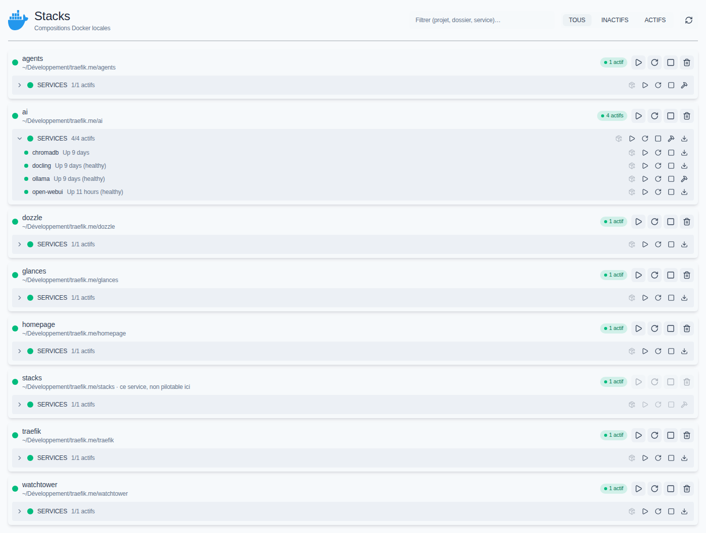
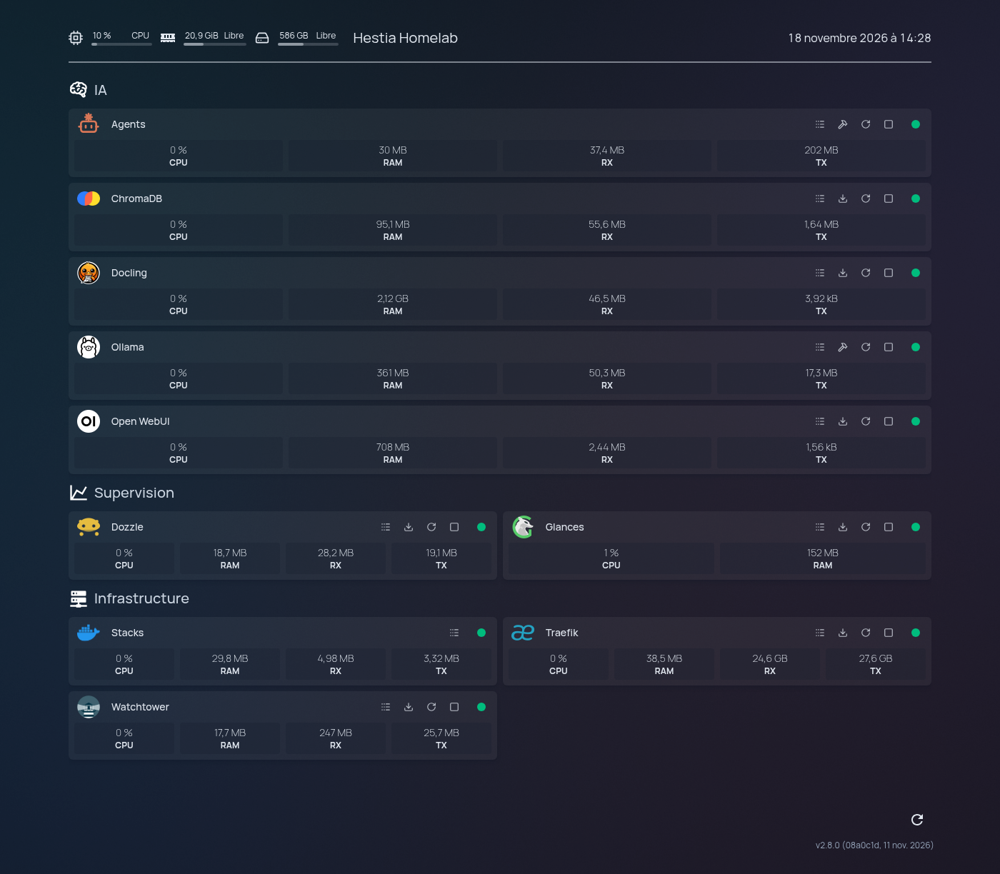
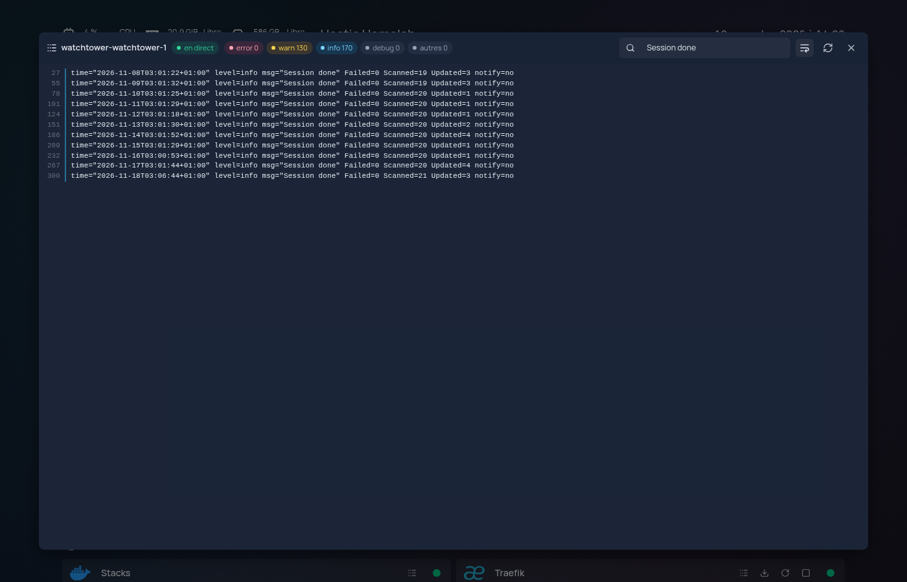

# Stacks (compositions Docker locales)

Outil **personnel, local uniquement**, qui pilote les projets Docker Compose du poste depuis le navigateur :

- une page `stacks` liste les projets trouvés dans plusieurs dossiers, lancés ou non, avec leurs services
  regroupés par profil Compose, et permet de les lancer, arrêter, redémarrer, reconstruire ou supprimer (projet
  entier, groupe de services ou service seul) ;
- dans un dashboard [Homepage][homepage], il ajoute des boutons aux cartes des conteneurs (logs en direct, rebuild
  ou pull, redémarrer, démarrer / arrêter), une recherche et un filtre Actifs / Inactifs / Tous. Sa propre carte
  (groupe `Infrastructure`) ouvre la page `stacks`.

Il est pensé pour un homelab où chaque service est un projet Compose dans son propre dossier, derrière un reverse
proxy [Traefik][traefik] et un dashboard Homepage qui découvrent les conteneurs par leurs labels. `stacks` est un
projet Compose comme les autres : son `compose.yaml` le branche sur le réseau externe `traefik` et l'expose par ses
labels. Pas de restart policy : il ne démarre que sur demande.

## Captures

Page `stacks` : pastilles d'état du projet (détail au survol), services dépliés d'un projet, actions par projet,
groupe ou service, et le projet de `stacks` lui-même, affiché mais non pilotable.



Cartes du dashboard avec les boutons ajoutés par `stacks` (logs, rebuild ou pull, redémarrer, arrêter). La recherche
et le filtre Actifs / Inactifs / Tous s'ajoutent sous la barre d'onglets, quand le dashboard en a une.



Logs en direct d'un conteneur, ouverts depuis sa carte : numéros de ligne, compteurs par niveau et filtre sur le
texte (ici, le bilan de chaque nuit de Watchtower).



## Prérequis

- Docker avec le plugin Compose v2.
- Un réseau Docker externe `traefik`, un [Traefik][traefik] qui lit les labels des conteneurs (provider Docker) et un
  dashboard Homepage joignable sur ce réseau (`http://homepage:3000` par défaut, voir `STACKS_DASHBOARD_URL` dans
  `compose.yaml`).
- Les projets à piloter sous `$HOME`.

Aucune modification de la configuration de Homepage : tout passe par les labels Traefik et Homepage de `stacks`, qui
disparaissent avec lui.

## Démarrage

```bash
git clone https://github.com/guillaumedelre/stacks.git && cd stacks
cp stacks.yaml.dist stacks.yaml   # dossiers à parcourir, profils par défaut
cp .env.dist .env                 # IP et DOMAIN du dashboard
docker compose up -d --build
```

- URL : `http://stacks.${IP}.${DOMAIN}` (le sous-domaine est le nom du dossier), aussi ouverte par la carte `Stacks`
  du dashboard.
- Arrêt : `docker compose down` (ou `stop` : sa carte reste alors dans le dashboard, arrêtée).
- Les sources sont copiées dans l'image, sans volume : après une modification, relancer
  `docker compose up -d --build`.

## Configuration (`stacks.yaml`)

| Clé | Rôle |
|---|---|
| `roots` | Dossiers parcourus à la recherche de `compose.yaml`, `compose.yml`, `docker-compose.yaml`, `docker-compose.yml`. Ils doivent être sous `$HOME` |
| `max_depth` | Profondeur de recherche sous chaque dossier (`node_modules`, `vendor`, `.git`, `var` sont ignorés) |
| `exclude` | Dossiers ignorés, avec leurs sous-dossiers |
| `projects.<nom>.profiles` | Profils lancés par le bouton **Lancer** du projet (le nom est celui du projet Compose) |
| `projects.<nom>.confirm` | Demande une confirmation avant chaque action |

Les projets déjà connus de Docker (`docker compose ls --all`) sont ajoutés même hors de `roots`. Le fichier est
relu à chaque clic sur ↻, sans redémarrage.

## Page `stacks`

### États

- **Pastilles** du projet, une par état présent, avec les services concernés au survol : `n actifs`,
  `n unhealthy`, `n en boucle` (redémarrages), `n arrêtés`, `n créés` (jamais démarrés), `aucun conteneur`
  (jamais lancé ou supprimé), `config invalide` (`docker compose config` en échec, message affiché sous le
  projet). Une action en cours remplace les pastilles.
- **Santé** : lue dans le statut Docker (`(healthy)`, `(unhealthy)`, `(health: starting)`). Un conteneur
  `unhealthy` passe le point du service, de son groupe et du projet en rouge ; `health: starting` donne un
  point orange.
- **Conteneurs orphelins** : conteneurs du projet dont le service n'existe plus dans le compose (renommé,
  supprimé, ou déclaré sur une autre branche), listés sous le projet. Rien n'est signalé tant que la
  configuration est invalide.
- **Groupes de profil**, repliés par défaut, avec leur compteur : un clic sur l'en-tête déplie les services
  (`sans profil` en premier, `services` pour un projet sans profil ; un service à plusieurs profils apparaît dans
  chacun).

### Actions

Icônes [Lucide][lucide], libellé et détail en tooltip (un bouton désactivé garde le sien). Toutes les commandes
tournent dans le dossier du projet, donc avec son `compose.override.yaml` et son `.env`.

| Action | Projet | Groupe ou service |
|---|---|---|
| **Lancer** / **Démarrer** | `--profile <profils de stacks.yaml> up --detach` ; sans profil configuré, seuls les services sans profil démarrent | `up --detach <services>`, avec leurs dépendances (`depends_on`), même si leur profil n'est pas activé |
| **Redémarrer** | `--profile '*' restart` | `restart <services>` |
| **Arrêter** | `--profile '*' stop` (les conteneurs restent dans Homepage) | `stop <services>` |
| **Supprimer** | `--profile '*' down` : conteneurs et réseaux supprimés, volumes gardés | |
| **Rebuild** | | `up --detach --build <services>`, pour les services qui ont une section `build` |
| **Pull** | | `pull <services>`, pour les autres (l'image d'un service construit n'existe souvent dans aucun registre). Ne redémarre rien : **Démarrer** recrée ensuite les conteneurs |
| **Créer** | | `create <services sans conteneur>` : conteneurs créés sans être démarrés, pour qu'ils apparaissent dans Homepage (qui ne découvre que les conteneurs existants) |

- Un groupe passe la liste explicite de ses services : `--profile <groupe> up` lancerait aussi tous les services
  sans profil.
- **Supprimer** sur les orphelins : `docker rm --force <conteneurs>`, Compose n'ayant pas de commande qui ne
  supprime que les orphelins (`up --remove-orphans` lance aussi le projet).
- Une action sur le projet bloque les autres actions du projet ; les actions sur des services distincts peuvent
  tourner en parallèle.
- La sortie de chaque commande s'affiche sous le projet, le groupe ou le service concerné. Elle reste dépliée et à
  la même position de défilement d'un rafraîchissement à l'autre, et suit la fin tant qu'on ne remonte pas.

### Recherche et filtres

Dans l'en-tête : la recherche porte sur le nom du projet, son dossier et ses services (seuls les services
correspondants s'affichent, dans des groupes dépliés), le filtre **Tous** / **Inactifs** / **Actifs** sur l'état
du projet, et ↻ relance la recherche des projets.

### États en direct

Un thread suit `docker events` (événements de conteneur qui changent un état : `create`, `start`, `stop`, `die`,
`destroy`, `health_status`..., sans les `exec_*` déclenchés par chaque healthcheck), relit `docker ps` une fois
par rafale (300 ms) et pousse le résultat en [server-sent events][sse] sur `GET /api/events`. Une relecture
toutes les 30 s rafraîchit les statuts (`Up 5 minutes`) et rattrape les événements manqués (redémarrage du
démon). La page `stacks` et les cartes du dashboard ouvrent chacune leur flux.

### Notifications

Une action qui se termine pendant que l'onglet est en arrière-plan affiche une notification du navigateur (✓ ou
✗, avec les dernières lignes de sortie en cas d'échec), depuis la page `stacks` comme depuis les cartes. La
permission est demandée au premier clic sur une action. L'API `Notification` n'existe qu'en contexte sécurisé :
HTTPS ou `localhost`, rien ne s'affiche en HTTP.

### Apparence

[Tailwind CSS][tailwind] v4, compilé au build de l'image par le binaire autonome (étape `css` du `Dockerfile`,
aucun CDN au chargement). `tailwind.css` reprend le mécanisme de thème de Homepage (classe `dark` sur `<html>`,
palette `theme-*` lue dans les variables `--color-50` à `--color-900`), en palette slate et dans le thème clair ou
sombre du système. En-tête dans le style `underlined` du dashboard, avec la même icône que la carte `stacks`.

## Dashboard Homepage

### Intégration

Deux routes Traefik, actives seulement quand `stacks` tourne, branchent l'outil sur l'hôte du dashboard :

- `Host(${IP}.${DOMAIN}) && Path(/api/config/custom.js)` : `stacks` sert le `custom.js` de Homepage (lu sur
  `STACKS_DASHBOARD_URL`), suivi de `ui.js` et `cards.js`, en `Cache-Control: no-store`. Homepage n'envoyant
  qu'un `ETag`, le navigateur revalide le fichier à chaque chargement : dès que `stacks` est arrêté, Homepage sert
  de nouveau le sien.
- `Host(${IP}.${DOMAIN}) && PathPrefix(/stacks-api)` (préfixe retiré) : l'API de `stacks` sur la même origine
  que le dashboard, sans CORS.

Le script relie chaque carte (`li.service[data-name]`, départagée par le nom du groupe) à son conteneur via
`/api/services` de Homepage, et suit l'état des conteneurs avec `GET /api/events`.

### Boutons des cartes

Mêmes icônes et même ordre que la page `stacks`. Le bouton de l'action en cours tourne, les autres sont grisés.

| Bouton | Commande |
|---|---|
| **Logs** | Fenêtre de logs en direct (voir plus bas) |
| **Rebuild** | `up --detach --build <service>`, pour un service avec une section `build` |
| **Pull** | `up --detach --pull=always <service>`, pour les autres : contrairement au **Pull** de la page `stacks`, le conteneur est recréé si l'image a changé, sans quoi la nouvelle image n'atteindrait jamais un conteneur en marche |
| **Redémarrer** | `restart <service>`, grisé si le conteneur est arrêté |
| **Démarrer** / **Arrêter** | `up --detach <service>` / `stop <service>` |

- Les commandes passent par `docker compose -p <projet> -f <fichiers>`, d'après les labels Compose du conteneur.
  Un conteneur hors Compose, ou dont les fichiers sont hors de `$HOME`, est piloté par
  `docker start|stop|restart` et n'a pas de bouton Rebuild / Pull, pas plus qu'un orphelin.
- La carte de `stacks` n'a que le bouton de logs : le service ne pilote pas son propre projet.
- Seuls les conteneurs existants ont une carte : le bouton **Créer** de la page `stacks` fait apparaître celle d'un
  service jamais lancé.

### Fenêtre de logs

- `docker logs --follow --tail 300`, en [server-sent events][sse] sur `GET /api/containers/<nom>/logs`, codes ANSI
  retirés, 5000 lignes gardées.
- **Numéros de ligne** dans une gouttière, comme dans un éditeur : numérotés dans le flux, ils ne changent pas
  quand un filtre masque des lignes ou que les plus anciennes sont retirées, et ne sont pas copiés avec le texte
  sélectionné.
- **Niveaux** : chaque ligne est colorée selon son niveau (error en rouge, warn en jaune, info avec un liseré bleu,
  debug atténué), détecté dans un champ JSON (`"level"`, `"level_name"`, `"severity"`, niveaux numériques pino), un
  `level=` / `lvl=`, un `canal.NIVEAU:` Monolog, un `[niveau]`, puis un mot en majuscules (`ERROR`, `WARN`...). Une
  ligne de stack trace (indentée, `#0 `, `at `) prend le niveau de la ligne précédente.
- **Filtres** : une pastille par niveau (`error`, `warn`, `info`, `debug`, `autres`) donne le nombre de lignes et
  masque ou affiche ce niveau au clic (choix mémorisé par navigateur, `localStorage`) ; un champ filtre les lignes
  sur leur texte.
- **État du flux** : `en direct`, `connexion`, `reconnexion`, `flux terminé`, `déconnecté`, détail au survol.
  Quand le conteneur s'arrête, le flux se termine sans reconnexion automatique, qui renverrait la fin des logs en
  boucle : bouton **Reconnecter**.
- Boutons retour à la ligne, reconnecter et fermer. `Échap` vide le filtre, puis ferme la fenêtre. Le défilement
  suit la fin tant qu'on ne remonte pas.
- Un ping toutes les 15 s permet au serveur de tuer le `docker logs` d'un onglet fermé.

### Recherche, filtre et tooltips

- Filtre **Actifs** (par défaut) / **Inactifs** / **Tous** sous les onglets : un conteneur `running` ou
  `restarting` est actif. Les cartes sans conteneur (liens, services hors Docker) restent toujours visibles. Le
  choix est mémorisé par navigateur (`localStorage`).
- Champ **Rechercher un conteneur** à gauche du filtre : masque les cartes dont le titre ne contient pas le texte
  saisi, en plus du filtre d'état. `Échap` le vide. Les touches tapées n'ouvrent pas la recherche rapide
  (quicklaunch) de Homepage.
- Erreurs des boutons dans un toast, qui se ferme au clic.
- **Tooltips** : tout élément du dashboard qui porte un attribut `title` (boutons de `stacks`, points d'état de
  Homepage...) affiche une bulle aux couleurs du thème à la place de l'infobulle native, lente à apparaître. Le
  `title` est déplacé dans `data-tip` au premier survol, ce qui couvre aussi les éléments rendus plus tard par
  React.
- Dépend des classes internes de Homepage (`li.service`, `.service-container-stats`, `.services-group`) : une mise à
  jour de Homepage peut faire disparaître les boutons, sans autre effet.

## API

| Méthode et chemin | Rôle |
|---|---|
| `GET /api/projects` | Recherche des projets (relit `stacks.yaml`) |
| `GET /api/states` | Conteneurs par projet Compose |
| `GET /api/events` | États poussés à chaque changement ([server-sent events][sse]) |
| `POST /api/projects/<id>/<action>` | `up`, `stop`, `down`, `create`, `restart`, `build`, `pull`, `remove-orphans` ; corps JSON `{"profiles": [], "services": []}` |
| `GET /api/jobs/<id>` | État et sortie d'une action (gardés 15 min après la fin) |
| `GET /api/containers/<nom>` | Bouton de mise à jour d'une carte : `{"update": "build" \| "pull" \| null, "self": bool}` |
| `POST /api/containers/<nom>/<action>` | `start`, `stop`, `restart`, `update` |
| `GET /api/containers/<nom>/logs` | Logs en direct ([server-sent events][sse]) |
| `GET /api/health` | Healthcheck de l'image |

Les `POST` exigent l'en-tête `X-Stacks-Request: 1` et, quand le navigateur l'envoie, une `Origin` égale à l'hôte.

## Fichiers

| Fichier | Rôle |
|---|---|
| `server.py` | Serveur HTTP (Python, bibliothèque standard + PyYAML) : recherche des projets, actions, flux d'états et de logs |
| `index.html` | Page `stacks` |
| `cards.js` | Boutons, filtre, recherche et fenêtre de logs ajoutés au dashboard |
| `ui.js` | Icônes et tooltips, partagés par la page et le dashboard |
| `tailwind.css` | Point d'entrée Tailwind, compilé en `app.css` au build |
| `compose.yaml` | Service, labels Traefik et Homepage |
| `stacks.yaml.dist`, `.env.dist` | Modèles à copier en `stacks.yaml` et `.env` (ces copies sont gitignorées) |

## Points d'attention

- `$HOME` est monté en lecture seule **au même chemin que sur l'hôte** : le démon Docker résout les bind mounts
  relatifs (`./src:/app`) côté hôte, et Compose résout `~` / `${HOME}` avec le `HOME` du conteneur.
- Les identifiants de registre (`~/.docker/config.json`) sont copiés au démarrage dans un volume, la CLI ayant
  besoin d'un `DOCKER_CONFIG` inscriptible. Un `docker login` fait après le démarrage demande un redémarrage de
  `stacks`.
- Le service ne pilote pas son propre projet.
- **Sécurité** : accès en écriture au socket Docker, sans authentification, ce qui équivaut à un accès root à la
  machine. Les en-têtes exigés sur les `POST` bloquent les requêtes envoyées par une autre page du navigateur. À ne
  jamais exposer hors du poste.

[homepage]: https://gethomepage.dev
[traefik]: https://doc.traefik.io/traefik/
[tailwind]: https://tailwindcss.com
[lucide]: https://lucide.dev
[sse]: https://html.spec.whatwg.org/multipage/server-sent-events.html
